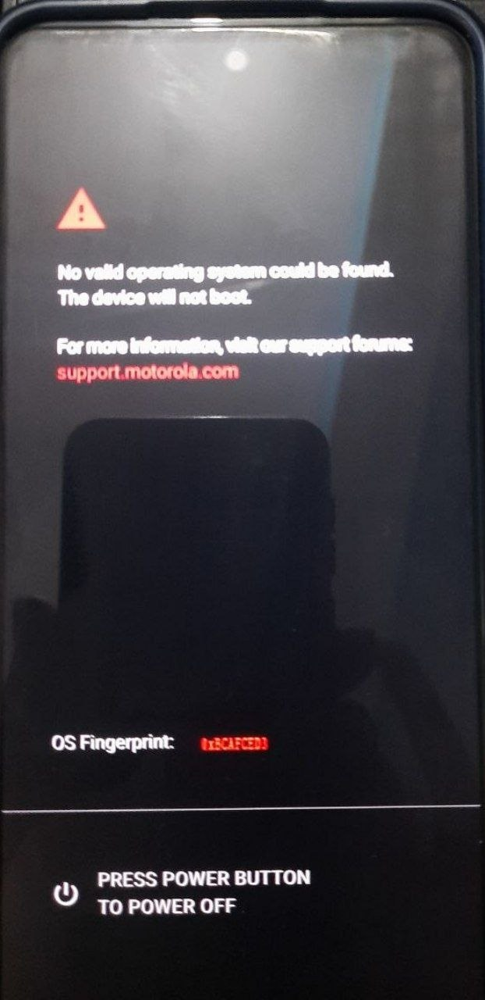

# How to flash stock rom & lock the bootloader in Moto G73 5G

**Before you start:** 
- Read the guide carefully.
- Follow the steps from top to bottom.
- This guide understands the user has previous knowledge and may only provide necessary steps.
- Remember flashing carries risk and this guide or maker won't be liable for damage or mishap.

## Anti-Rollback (ARB)
Simply put, it is a mechanism to prevent flashing old firmware.

* Read [Check ARB](#check-arb) for checking device ARB and read below to understand ARB limits respective to your version and device.

* **Pre-ARB :** From the first A13 update to the last A13 update (Secure bootloader `0x0`):

  * `T1TNS33.14-44-2` --> `T1TNS33.14-90-9-3-1-2` (last A13 build)
  * **Do NOT** relock bootloader on A13
  * Locking is not recommended, though the device can be used safely while unlocked.

* **ARB :** From the first A14 update to the August 2026 security patch (Secure bootloader `0x1`):

  * **Global :** `U1TNS34.82-12-7` --> `U1TNS34.82-12-7-25`
  * **EU :** `U1TNS34.82-12-7` --> `U1TNS34.82-12-17-19`
  * **Do NOT** flash below allowed ARB level or device **will hardbrick**

* **ARB_v2 :** From the A14 October 2026 patch and onwards (Secure bootloader `0x2`):

  * **Starts from :** `U1TNS34.82-12-7-26` (Global) and `U1TNS34.82-12-17-20` (EU)
  * If your device is on or above this patch, **DO NOT** flash below it or any older A14/A13 stock ROM builds, or **it will hard-brick**.

## Check ARB

* Check ARB for Devonf device
* Run :

  ```
  fastboot getvar version-bootloader
  fastboot oem read_sv
  ```
* Example output :

  ```
  - (bootloader) version-bootloader[0]: MBM-3.1-devonf_g_vext-a9ce5-U1TNS34.
  - (bootloader) version-bootloader[1]: 82-12-7-25-86c959
  - (bootloader) Group0 (Secure bootloader) = 0x1
  ```
* Pre-ARB :
  * version-bootloader : between ```T1TNS33.14-44-2``` --> ```T1TNS33.14-90-9-3-1-2```
  * Secure bootloader : `0x0`

* ARB :
  * version-bootloader : between ```U1TNS34.82-12-7``` --> ```U1TNS34.82-12-7-25```, ```U1TNS34.82-12-17-19```
  * Secure bootloader : `0x1`

* ARB_v2 :
  * version-bootloader : ```U1TNS34.82-12-7-26```, ```U1TNS34.82-12-17-20``` --> above
  * Secure bootloader : `0x2`

## Notes
* Platform tools must be extracted inside ROM folder or set in environment PATH
* Downloaded the full stock firmware you want to flash.
* Remember to be always under ARB rules
* Use appropriate flash file for flashing from release: [Link](https://github.com/devonf-sources/devonf-docs/releases)
* Install drivers if needed:
  [Motorola Official Drivers](https://motorola-global-portal.custhelp.com/euf/assets/downloads/Motorola_Mobile_Drivers_64bit.msi)

## Requirements

* Stock ROM downloaded on PC
* Flash files added inside Extracted ROM folder
* **Backup all your important data including photos, videos, documents etc** - flashing will completely wipe your device.
* **Remove all Google accounts from the device** (to avoid FRP lock)
* **Remove screen lock** (PIN, pattern, or password)
* Ensure USB Debugging enabled in Developer options
* Motorola Official drivers installed
* Platform tools extracted in ROM folder or set in system PATH
* Ensure Device is detected in bootloader mode

## Flashing Steps

* Extract stock ROM on PC
* Place extracted flash file inside the ROM folder
* Ensure device is connected and detected in bootloader mode

  * If not detected, install Motorola Drivers and restart PC

* Flash using `flash_file.bat`:

  * Download Link : [Click here](https://github.com/devonf-sources/devonf-docs/releases)

* Match ROM version with correct **ARB level**
* Be inside ROM folder and check device connected
* Double click on ```flash_file.bat``` to start flashing
  * You can manually flash files with fastboot too
* Once flashing is done
* Reboot to system

## First Boot Setup

* Complete the initial device setup with an active internet connection.
* Turn off **Smart Updates in toggle** during setup
* Disconnect internet after setup
* Turn on Developer options
  * Enable **USB debugging**
  * Ensure **OEM unlocking is ON and greyed out**
  * If button is greyed out but not toggled ON, It's not a concern if device is unlocked.

## Relock Bootloader

> ⚠️ **WARNING:** If you are on a custom ROM, rooted stock ROM, or have any system modifications, **flash the clean stock ROM first** before proceeding. Locking the bootloader on modified firmware will brick your device.

* Boot the device in bootloader mode
* To lock the bootloader, Run:

  ```
  fastboot oem lock
  ```

* On Phone Screen select `lock the bootloader`
  * navigate with volume keys and power button to enter.
* Once lock is done
* Reboot to system

## If Stuck on "No valid operating system could be found.”



---

* Press Power button from that screen to Power Off
* Boot to bootloader mode
* Re-flash newer version of stock ROM using flash_file
  * If you get pre-flash validation failed, reboot to bootloader again and try again
* Ensure correct ARB rules
* Reboot to system
* Reboot normally

## Final Steps

* Complete setup
* Go to Developer Options
* OEM Unlocking can now be disabled
* Disable OEM unlocking and reboot
* Enjoy! Your device is now locked.
